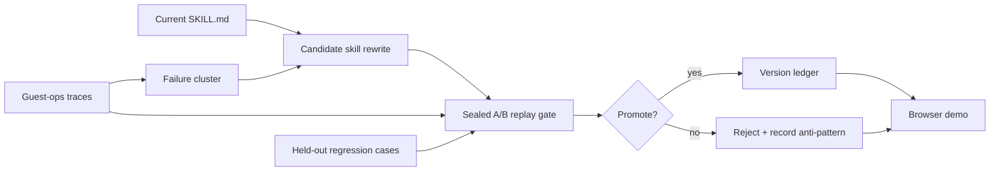

# reSKILL

**A sealed replay gate for self-improving agent skills.**

reSKILL is a prototype controller for agent teams that rewrite their own operating instructions. Instead of promoting every model-proposed edit, reSKILL runs each candidate skill through a visible A/B gate: target failures must improve, held-out regression cases must stay intact, and only non-regressing versions are eligible for promotion.

The core idea is simple:

> AI should not just edit itself. It should reject its own unsafe edits.

## Architecture



## What Is In This Repo

- `server.js` - Express API for health, replay, cached spine, and version-ledger state.
- `index.html` - Browser UI for the replay gate.
- `index.css` - Visual system for the two-pane demo.
- `app.js` - Frontend state, trace timeline, diff rendering, voice narration, and replay flow.
- `runs/spine.json` - Cached run used for deterministic demos.
- `docs/specs/reskill.md` - Public product spec and acceptance criteria.
- `docs/architecture.md` - Component diagram and data flow.
- `data/dev-traces.json` - Public development traces.
- `data/heldout-traces.sample.json` - Non-private sample held-out traces.
- `skills/guest_dispute_resolution.md` - Example skill under test.
- `scripts/gate.js` - Deterministic replay scorer.
- `scripts/speedrun.js` - Reproducible local replay run and ledger writer.

## Run Locally

```bash
npm install
npm start
```

Then open [http://localhost:8000](http://localhost:8000).

## Reproduce The Gate

Run a local, deterministic speedrun:

```bash
npm run speedrun
```

This writes:

- `runs/latest.json`
- `runs/leaderboard.tsv`

Try different local candidates:

```bash
RESKILL_CANDIDATE=baseline npm run speedrun
RESKILL_CANDIDATE=overbroad npm run speedrun
RESKILL_CANDIDATE=constrained npm run speedrun
```

## Demo Loop

1. Load the William dispute case.
2. Run the current skill and show the unresolved failure.
3. Generate an overbroad rewrite that fixes William but breaks held-out safety cases.
4. Watch the replay gate reject it.
5. Refine the rule, rerun the gate, and promote only when regressions are zero.

## Public Boundary

This repository contains the public scaffold and sample data only. Private traces, real production credentials, judging strategy, prize targeting, and non-public research notes stay outside the repo.
