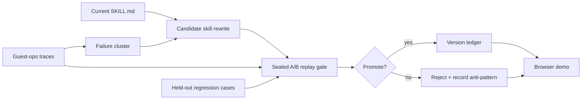

# reSKILL

**A sealed replay gate for self-improving agent skills.**

> **Status: Reference (prototype).** Built 2026-06-27/28; last meaningful
> update: PR #1 (deterministic replay gate) merged 2026-06-28.

reSKILL is a controller for agent teams that rewrite their own operating
instructions. Instead of promoting every model-proposed edit, it runs each
candidate `SKILL.md` through an A/B replay gate: target failures must improve,
held-out regression cases must stay intact, and only non-regressing versions
are promoted.

> AI should not just edit itself. It should reject its own unsafe edits.

## Architecture



The demo domain is short-term-rental guest operations
(`skills/guest_dispute_resolution.md`). The browser UI can call Gemini to
propose rewrites; the gate itself is deterministic and needs no external API.

## Demo loop

1. Load the dispute case.
2. Run the current skill and show the unresolved failure.
3. Generate an overbroad rewrite that fixes the case but breaks held-out safety cases.
4. Watch the gate reject it.
5. Refine the rule, rerun, and promote only when regressions are zero.

Recorded leaderboard (`runs/leaderboard.tsv`): `constrained` promoted (3/3 dev,
2/2 held-out, 0 regressions); `overbroad` rejected (1/3 dev, 0/2 held-out).

## How it fits

reSKILL applies the same idea as Nightshift's evaluator backpressure (a builder
never grades its own work) to skill files instead of code. It is a standalone
prototype and is not wired into Nightshift.

## Layout

```txt
server.js                          Express API: health, replay, cached spine, ledger
index.html, index.css, app.js      browser UI (trace timeline, diff, narration)
scripts/gate.js                    deterministic replay scorer
scripts/speedrun.js                local replay run + ledger writer
skills/guest_dispute_resolution.md example skill under test
data/dev-traces.json               public development traces
data/heldout-traces.sample.json    non-private sample held-out traces
runs/                              cached spine, latest run, leaderboard
docs/specs/reskill.md              product spec and acceptance criteria
docs/architecture.md               components and data flow
```

## Run

```sh
npm install
npm start                 # http://localhost:8000 (PORT overrides)
npm run check             # syntax check
npm run speedrun          # writes runs/latest.json and runs/leaderboard.tsv
RESKILL_CANDIDATE=baseline    npm run speedrun
RESKILL_CANDIDATE=overbroad   npm run speedrun
RESKILL_CANDIDATE=constrained npm run speedrun
```

## Config and secrets

- `PORT` (optional).
- Gemini rewrites in the browser use a key the user supplies at runtime; no key
  is stored in the repo.
- Private traces, credentials, and event notes stay outside the repo by design.

## Maintenance notes

- Gemini model names in `app.js` date from mid-2026.
- Recommended: archive once no further demos are planned.

## License

MIT
