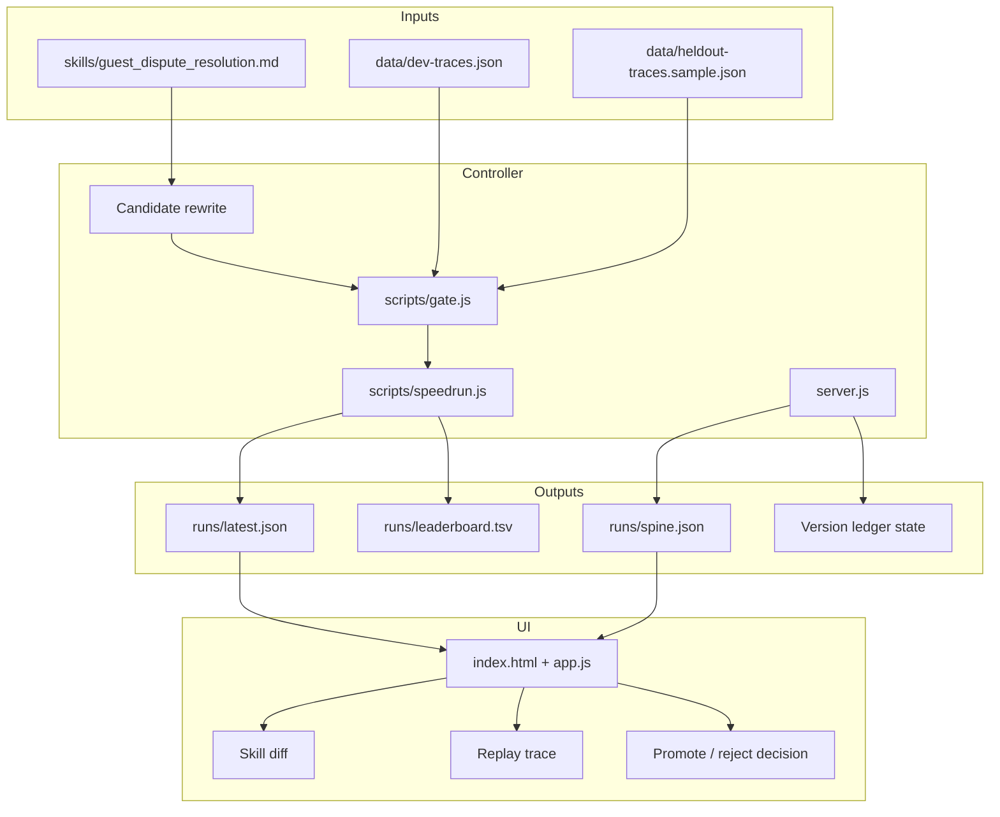

# reSKILL Architecture

reSKILL is split into two layers:

- The demo shell: browser UI, cached spine, voice narration, trace timeline, and diff view.
- The gate spine: skill artifact, traces, replay scorer, and version ledger.

## Component Diagram

## Gate Decision

The gate promotes a candidate only when all conditions are true:

1. Development-set score improves over the baseline.
2. Held-out score does not decline.
3. Held-out regression count is zero.
4. The candidate does not match a known unsafe anti-pattern.

## Data Boundary

The public repo may include sample development and held-out traces. Real private traces should stay outside the repo and be loaded only by local or deployed environments with explicit access.

## Failure Modes

- Overbroad candidate: fixes the visible case but grants refunds too broadly.
- Narrow candidate: preserves safety but fails to resolve the target case.
- Non-deterministic candidate: cannot be scored consistently and should be rejected.

## Local Reliability

The browser demo uses `runs/spine.json` so the visible path remains deterministic. The command-line harness is the reproducible path for validating the underlying gate.
